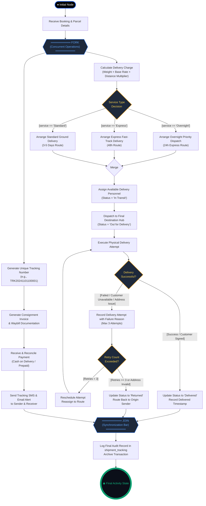
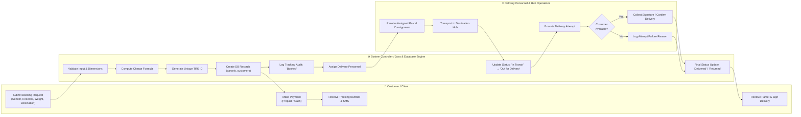

# Activity Diagram — Courier and Parcel Tracking Management System

> **Course:** 25ITT33 Software Engineering · Unit 3: Software Design & Modeling  
> **Scenario 26:** Courier and Parcel Tracking Management System  
> **Author:** Dharshan S (Reg. No: 26, Class: 25IT3A)  
> **Institution:** Velalar College of Engineering and Technology, Erode-12

---

## 📌 Overview

An **Activity Diagram** models the dynamic, procedural control flow and business workflow of a system. It captures sequential activities, concurrent execution paths (using fork and join bars), decision branches (guard conditions), and terminal states.

In this Courier and Parcel Tracking Management System, the activity diagram models the end-to-end lifecycle of parcel booking, concurrent physical dispatch processing versus billing/waybill notification generation, and the final delivery attempt resolution.

---

## 📊 UML Activity Diagram (UML 2.5 Standard)

---

## 🏊 Swimlane / Partition Diagram

To clarify which subsystem or role owns each activity, the workflow is organized into three organizational swimlanes:

---

## 📋 Activity Workflow Specifications

### 1. Initial State & Order Reception
- **Action:** User/Admin enters booking information via the Web Portal or Java Console (`Main.java`).
- **Data Required:** Sender ID, Receiver ID, Parcel Type, Weight (kg), Destination, Distance Category (`Local`, `Regional`, `National`, `International`), and Service Type (`Standard`, `Express`, `Overnight`).

### 2. Fork Synchronization (Concurrency)
Once validated, the process splits into **two concurrent threads**:
1. **Physical Logistics Thread:**
   - Evaluates service type priority (`Overnight` $\rightarrow$ high-priority air route, `Express` $\rightarrow$ express surface, `Standard` $\rightarrow$ regular ground).
   - Queries `delivery_personnel` for available personnel in the target delivery zone.
   - Updates `delivery_assignments` and sets parcel status to `In Transit`.
   - Transitions to `Out for Delivery` when assigned staff initiates the route.
2. **Billing & Customer Communication Thread:**
   - Auto-generates a collision-free 14-character tracking code (`TRK` + `YYYYMMDDHHMMSS` + `4-digit random`).
   - Issues invoice billing statement:
     $$\text{Charge} = \text{Weight} \times \text{BaseRate} \times \text{DistanceMultiplier}$$
   - Reconciles payment and emits tracking notification via SMS/Email webhook.

### 3. Delivery Attempt & Exception Handling
- The courier agent attempts delivery at the receiver's address.
- **Success Path:** Customer signs acknowledgment $\rightarrow$ status becomes `Delivered` $\rightarrow$ `delivered_date` set to current timestamp.
- **Failure Path:** Customer unavailable, premises locked, or incorrect address:
  - System logs an entry in `delivery_attempts` with specific failure reason.
  - If attempts $< 3$: Route rescheduled for next business day.
  - If attempts $\ge 3$ or address unresolvable: Parcel marked `Returned` and routed back to origin sender.

### 4. Join Synchronization & Final State
- Both physical delivery resolution and administrative invoice records synchronize at the **Join Bar**.
- The tracking history audit log in `shipment_tracking` is closed and committed.
- Reaches the terminal **Final Activity State**.
