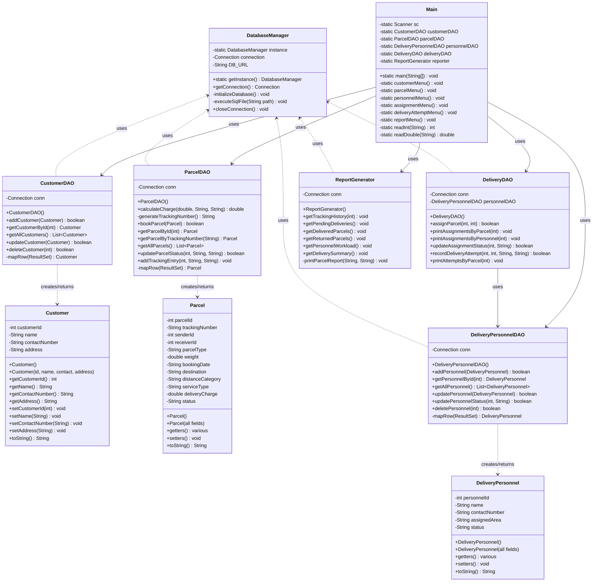

# Class Diagram — Courier and Parcel Tracking Management System

## Class Diagram

---

## Design Patterns Used

| Pattern | Where Used | Purpose |
|---|---|---|
| **Singleton** | `DatabaseManager` | Single DB connection throughout app lifecycle |
| **DAO (Data Access Object)** | All `*DAO` classes | Separation of DB logic from business logic |
| **POJO** | `Customer`, `Parcel`, `DeliveryPersonnel` | Simple data containers with getters/setters |
