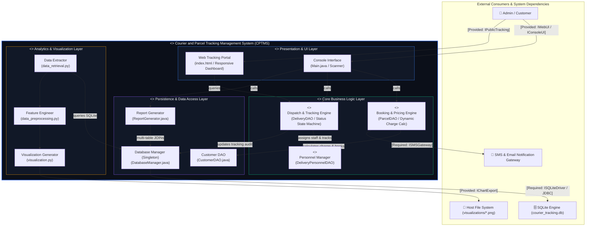

# Component Diagram — Courier and Parcel Tracking Management System

> **Course:** 25ITT33 Software Engineering · Unit 3: Software Design (Component-Level Design)  
> **Scenario 26:** Courier and Parcel Tracking Management System  
> **Author:** Dharshan S (Reg. No: 26, Class: 25IT3A)  
> **Institution:** Velalar College of Engineering and Technology, Erode-12

---

## 📌 Overview

A **UML Component Diagram** describes the structural organization and relationships among software modules, encapsulated subsystems, ports, and interfaces. Following UML 2.5 standards:
- **Components (`<<component>>`)**: Modular, replaceable units of system functionality with internal hidden implementations.
- **Ports (⚲ / □)**: Distinct interaction points on a component's boundary.
- **Provided Interfaces (○ Lollipop Notation)**: Services that a component implements and offers to clients or peer modules.
- **Required Interfaces ( ) Socket Notation)**: Services that a component requires from another component or environment to perform its function.

---

## 🏗️ UML Component Diagram (Component-Level Architecture)



---

## 🧩 Component Specifications & Interface Contracts

The system is decomposed into five autonomous, cohesive components communicating through strictly typed interfaces:

| Component | Responsibility | Provided Interfaces (○) | Required Interfaces ( ) | Implementation Files |
|---|---|---|---|---|
| **`PresentationComponent`** | Renders console CLI and responsive browser dashboards; captures user input and presents formatted tables and timelines. | `IConsoleUI`<br>`IWebPortal`<br>`ITrackingView` | `IBookingService`<br>`ITrackingService`<br>`IReportService` | `Main.java`<br>`index.html` |
| **`BookingPricingEngine`** | Generates collision-free tracking numbers (`TRK...`), validates weights and destinations, and calculates dynamic delivery charges. | `IBookingService`<br>`IPriceCalculator`<br>`IParcelValidator` | `ICustomerDAO`<br>`IParcelDAO`<br>`IAuditLog` | `ParcelDAO.java`<br>`Parcel.java` |
| **`DispatchTrackingEngine`** | Manages shipment status transitions (`Booked` $\rightarrow$ `In Transit` $\rightarrow$ `Out for Delivery` $\rightarrow$ `Delivered`/`Returned`), delivery assignments, and attempt logs. | `ITrackingService`<br>`IAssignmentService`<br>`IAttemptRecorder` | `IDeliveryStaffDAO`<br>`IAuditLogger`<br>`ISMSGateway` | `DeliveryDAO.java`<br>`DeliveryPersonnelDAO.java` |
| **`PersistenceManager`** | Encapsulates database connections, SQL query execution, transaction integrity, and schema initialization. | `IDatabaseConnection`<br>`ICustomerDAO`<br>`IParcelDAO`<br>`ISQLiteAccess` | `JDBC Driver (sqlite-jdbc)`<br>`FileSystem Storage` | `DatabaseManager.java`<br>`CustomerDAO.java`<br>`schema.sql` |
| **`AnalyticsEngine`** | Connects to the SQLite database via Python, preprocesses delivery duration and delays, and renders 6 distribution and trend charts. | `IAnalyticsExtractor`<br>`IChartGenerator`<br>`IDataCleaner` | `SQLite3 Native API`<br>`Matplotlib / Seaborn / Pandas` | `data_retrieval.py`<br>`data_preprocessing.py`<br>`visualization.py` |

---

## 🔌 Port & Interface Definitions (UML 2.5 Standard)

### 1. Port 1: `ClientPort` (Provided Interfaces)
- **Interface `IConsoleUI`**: Exposes operations `showMainMenu()`, `handleCustomerMenu()`, `handleParcelMenu()`, `handleReportMenu()`.
- **Interface `IWebPortal`**: Exposes REST-like JavaScript client methods:
  - `trackParcel(trackingNumber: String): ParcelDetailDTO`
  - `calculateCharge(weight: double, service: String, distance: String): double`
  - `bookSimulatedParcel(formData: JSON): BookingReceiptDTO`

### 2. Port 2: `PricingServicePort` (Internal Provided & Required)
- **Interface `IPriceCalculator`**:
  ```java
  double calculateDeliveryCharge(double weightKg, String serviceType, String distanceCategory);
  ```
  - *Contract Rule:* Base rates: Standard = ₹50/kg, Express = ₹80/kg, Overnight = ₹120/kg.
  - *Contract Rule:* Multipliers: Local = 1.0x, Regional = 1.5x, National = 2.0x, International = 3.5x.

### 3. Port 3: `AuditTrackingPort` (Internal Provided)
- **Interface `IAuditLogger`**:
  ```java
  void logTrackingEvent(int parcelId, String status, String location, String remarks);
  ```
  - Guarantees append-only persistence to `shipment_tracking` on every status alteration.

### 4. Port 4: `DatabasePort` (Required Interface)
- **Interface `ISQLiteDriver`**:
  - Connects using standard JDBC connection string: `jdbc:sqlite:database/courier_tracking.db`.
  - Enforces SQLite foreign key constraints: `PRAGMA foreign_keys = ON;`.
  - Employs `PreparedStatement` across all DAOs to guarantee protection against SQL Injection attacks.

---

## 🎯 Component Design Principles (Adherence to SE Principles)

1. **High Cohesion**: Each component encapsulates a singular domain responsibility (e.g., `BookingPricingEngine` only handles parcel booking and financial calculation, with zero knowledge of database drivers).
2. **Low Coupling**: The `PresentationComponent` interacts with business logic exclusively through DAO and Service interfaces, never writing raw SQL statements directly.
3. **Pluggability & Replaceability**: If the persistence storage changes from SQLite to MySQL or PostgreSQL, only `DatabaseManager` and SQL dialect statements need updating; presentation and analytics code remain untouched.
4. **Information Hiding**: Database connection handles, SQL query details, and internal state collections are marked `private` inside DAO components, exposing only clean DTOs (`Customer`, `Parcel`, `DeliveryPersonnel`).
