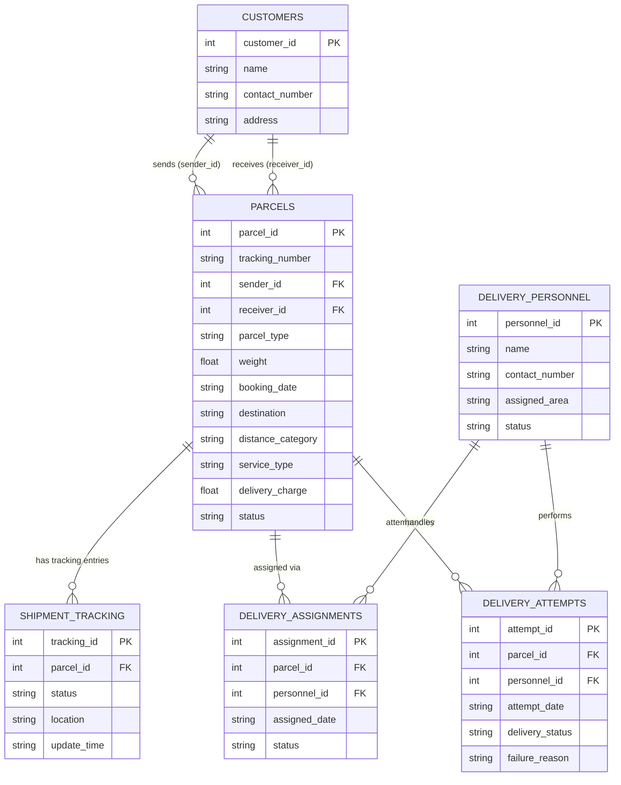

# ER Diagram — Courier and Parcel Tracking Management System

## Entity-Relationship Diagram

---

## Relationship Descriptions

| Relationship | Cardinality | Description |
|---|---|---|
| CUSTOMERS → PARCELS (sender) | One-to-Many | One customer can send many parcels |
| CUSTOMERS → PARCELS (receiver) | One-to-Many | One customer can receive many parcels |
| PARCELS → SHIPMENT_TRACKING | One-to-Many | Each parcel has multiple tracking events |
| PARCELS → DELIVERY_ASSIGNMENTS | One-to-Many | A parcel may be assigned to multiple personnel over time |
| PARCELS → DELIVERY_ATTEMPTS | One-to-Many | Multiple delivery attempts per parcel are possible |
| DELIVERY_PERSONNEL → DELIVERY_ASSIGNMENTS | One-to-Many | One person handles many assignments |
| DELIVERY_PERSONNEL → DELIVERY_ATTEMPTS | One-to-Many | One person performs many attempts |

---

## Attribute Constraints

| Entity | Constraint |
|---|---|
| `customers.customer_id` | Auto-increment PRIMARY KEY |
| `parcels.tracking_number` | UNIQUE NOT NULL |
| `parcels.parcel_type` | CHECK IN (Document, Small Package, Medium Package, Large Package, Fragile) |
| `parcels.distance_category` | CHECK IN (Local, Regional, National, International) |
| `parcels.service_type` | CHECK IN (Standard, Express, Overnight) |
| `parcels.status` | CHECK IN (Booked, In Transit, Out for Delivery, Delivered, Returned) |
| `delivery_personnel.status` | CHECK IN (Available, On Delivery, Off Duty) |
| `delivery_assignments.status` | CHECK IN (Assigned, In Progress, Completed, Failed) |
| `delivery_attempts.delivery_status` | CHECK IN (Successful, Failed) |
