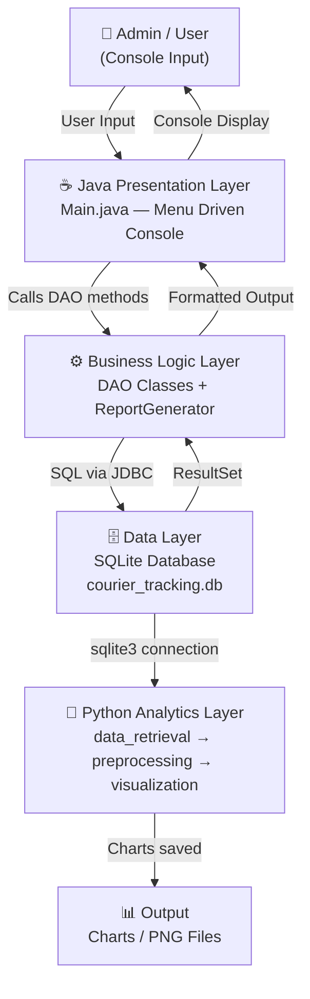
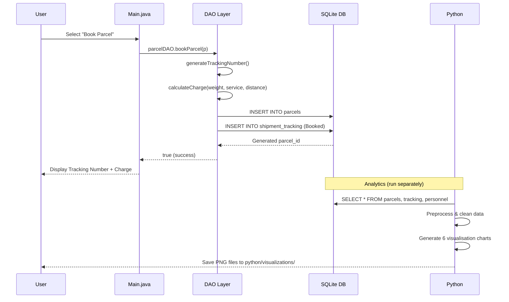

# System Architecture — Courier and Parcel Tracking Management System

## Architecture Overview
The system follows a **Three-Tier Architecture**:

---

## Component Descriptions

### Presentation Layer — `Main.java`
- Console menu system using `Scanner`
- Dispatches user selections to appropriate DAO/Report methods
- Formats and prints all output with table borders

### Business Logic Layer — DAO Classes

| Class | Responsibility |
|---|---|
| `DatabaseManager` | Singleton SQLite connection + schema initialisation |
| `CustomerDAO` | Full CRUD for customers |
| `ParcelDAO` | Parcel booking, tracking number generation, charge calculation, status updates |
| `DeliveryPersonnelDAO` | CRUD for delivery staff |
| `DeliveryDAO` | Parcel assignment + delivery attempt recording |
| `ReportGenerator` | Multi-table JOIN queries for all reports |

### Data Layer — SQLite (`courier_tracking.db`)
- 6 normalised tables
- Foreign key constraints enforced via `PRAGMA foreign_keys = ON`
- Schema auto-initialised on first run from `sql/schema.sql`

### Analytics Layer — Python
- `data_retrieval.py` — Connects to SQLite, returns pandas DataFrames
- `data_preprocessing.py` — Cleans data, derives features, exports CSV
- `visualization.py` — Generates 6 charts using matplotlib + seaborn

---

## Data Flow

---

## Technology Stack

| Component | Technology | Version |
|---|---|---|
| Programming Language | Java | 11+ |
| Database | SQLite | 3.42+ |
| JDBC Driver | sqlite-jdbc | 3.42.0.0 |
| Analytics | Python | 3.8+ |
| Data Manipulation | pandas | 1.5+ |
| Visualization | matplotlib + seaborn | 3.6+ / 0.12+ |
| Build | javac + batch script | — |
