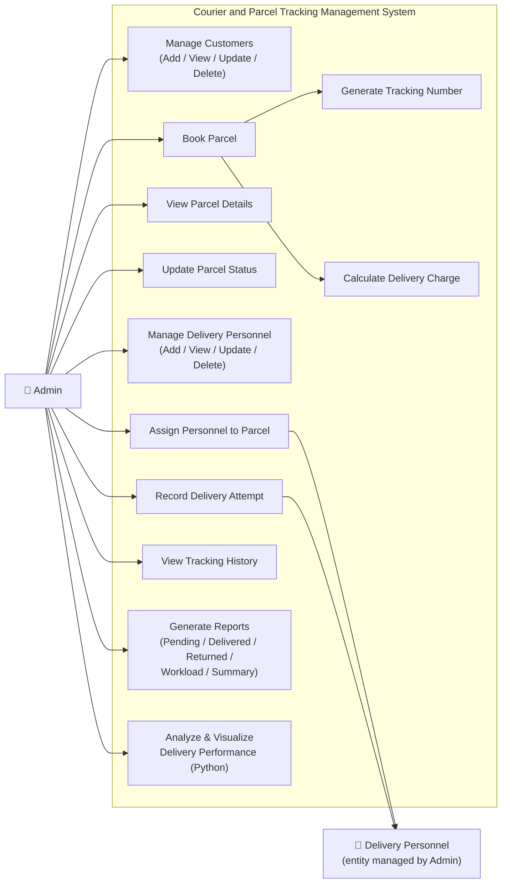

# Use Case Diagram — Courier and Parcel Tracking Management System

## Actors
- **Admin** — Primary user who operates all system features
- **Delivery Personnel** — Referenced entity; their details managed by Admin

## Use Case Diagram

---

## Use Case Descriptions

| Use Case | Actor | Description |
|---|---|---|
| Manage Customers | Admin | Add, view, update, delete customer records (sender/receiver) |
| Book Parcel | Admin | Register a new parcel with all details; triggers tracking number generation and charge calculation |
| Generate Tracking Number | System | Auto-generates unique TRK+timestamp+random number |
| Calculate Delivery Charge | System | Computes charge = weight × base_rate × distance_multiplier |
| View Parcel Details | Admin | Retrieve parcel by ID or tracking number |
| Update Parcel Status | Admin | Change status and log in shipment_tracking table |
| Manage Delivery Personnel | Admin | CRUD operations on delivery staff records |
| Assign Personnel to Parcel | Admin | Link a parcel to an available delivery person |
| Record Delivery Attempt | Admin | Log successful or failed delivery attempt with optional failure reason |
| View Tracking History | Admin | Show all status changes for a parcel with timestamps and locations |
| Generate Reports | Admin | Display pending, delivered, returned parcels and personnel workload |
| Analyze & Visualize (Python) | Admin | Run Python script to generate 6 performance charts from DB data |
